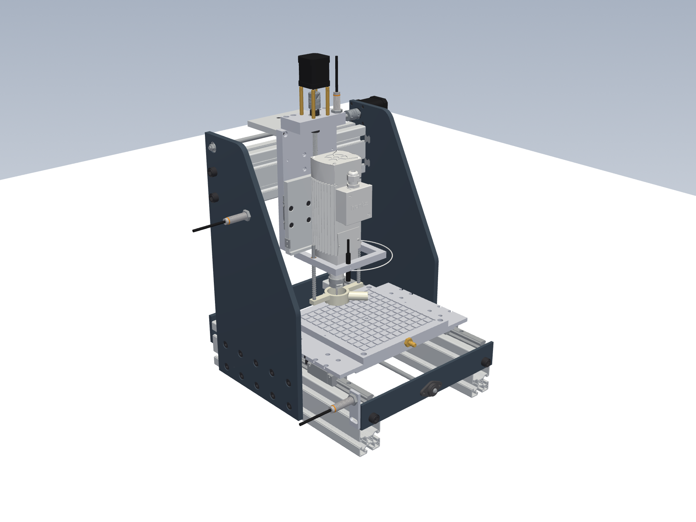
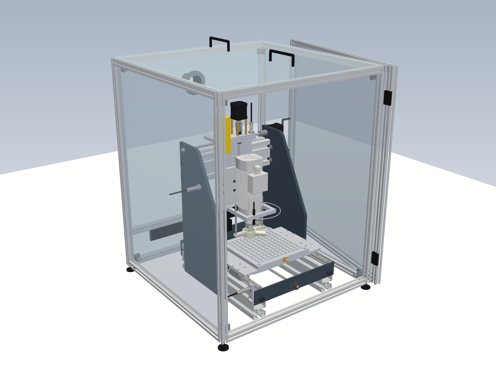
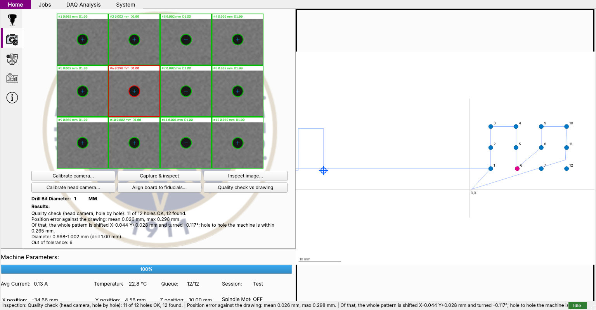

# Intelligent CNC Vertical Drilling Machine

Bachelor graduation project: a CNC vertical drilling machine for PCBs and plates with a desktop control app, live sensor monitoring (spindle current, temperature, vibration) and camera-based hole inspection.

| Upgraded machine | In its cover | Control app: quality check against the drawing |
|---|---|---|
|  |  |  |

Every improvement and where it lives: [IMPROVEMENTS.md](IMPROVEMENTS.md). Full CAD and pictures: [cad/UPGRADE.md](cad/UPGRADE.md).

- **Paper:** [Intelligent CNC Vertical Drilling Machine](https://www.researchgate.net/publication/408419810_Intelligent_CNC_Vertical_Drilling_Machine) (ResearchGate)
- **Video:** [the machine running on YouTube](https://www.youtube.com/watch?v=lhm-_ZcUPpU)

> **About this repository.** It holds the **improved version (v2)** of the project, not the exact code described in the paper. The control software was reworked for Ubuntu 22.04 (see [What changed and why](#what-changed-and-why)), and the mechanics and electronics were reviewed with proposed upgrades. It also contains a **new CNC router design**, still in the CAD stage (see [cad/router](cad/router/README.md)).

## Team

The original machine (v1) was a team project at Yıldız Technical University, Mechatronics Department, presented at
UTIS 2025. The authors of the paper:

- **Umut Karagüzel**: Yıldız Technical University, Mechatronics Department (supervisor)
- **Hasan Aytuğ Kurt**: Yılmaz Makine
- **Ahmed Mansour**: Yıldız Technical University, Mechatronics Department
- **Mustafa Almohamad**: Yıldız Technical University, Mechatronics Department

The machine, its electronics, software and DAQ module in v1 are the team's work. This repository's v2 (the reworked
control software, the review of the mechanics and electronics, the upgrade CAD and the CNC router design) is a later
rework by Mustafa Almohamad.

## Contents

```
app/            desktop application (PyQt6)
  main.py         window logic (same UI.ui, same pages, rewired)
  grbl.py         GRBL serial client: streaming, status, jog, reset
  session.py      runs a drilling job, progress, pause/cancel/E-stop
  jobs.py         points / command line / DXF parsing, hole ordering, G-code
  daq.py          DAQ board protocol (real values only)
  database.py     SQLite: sessions, holes, samples (+ import of old my_db.db)
  vision.py       camera calibration + hole measurement
  align.py        head camera calibration + fiducial alignment of the job
  analysis.py     stats and trend fitting
  ports.py        finds the boards on /dev/ttyUSB*
  config.py       config.yaml handling
firmware/
  daq/daq.ino     new DAQ board firmware (current RMS, spindle load, 2× DS18B20, ADXL345 FIFO)
  daq/sim_test/   runs the DAQ firmware on a simulated ATmega328P (simavr)
  grbl/README.md  motion board: stock GRBL 1.1h, rewiring, settings
electronics/    circuit review, improved diagrams, parts list
cad/            review measured from the original Parasolid assembly (xt/ reader), full upgrade (UPGRADE.md), STEP parts,
                home switches, electrical box, machine cover, stiffness check
  router/         new CNC router design (CadQuery): assembly, clash check, stiffness check, pictures
  original_solidworks/  the original SolidWorks design (Ana_Montaj_1_6_25.SLDASM, parts) and its Parasolid export
CALIBRATION.md  step-by-step calibration and acceptance test
sim/            virtual machine: GRBL + DAQ on virtual serial ports, camera images
tests/          61 automated tests (pytest), including a full GUI run on the simulator
```

A list of every improvement and where it lives is in [IMPROVEMENTS.md](IMPROVEMENTS.md).

## Install (Ubuntu 22.04)

```bash
sudo apt install python3-pip python3-venv libxcb-cursor0
sudo usermod -aG dialout $USER          # serial port access, then log out and back in
sudo apt remove brltty                  # it steals CH340 Nanos on 22.04
python3 -m venv ~/cnc-venv && source ~/cnc-venv/bin/activate
pip install -r requirements.txt
```

## Run without hardware (simulator)

```bash
python3 sim/run_sim.py --backlash 0.1          # terminal 1: virtual machine
CNC_CONFIG=sim/sim_config.yaml python3 -m app  # terminal 2: the app
```
In the app, go to Home and press Manual control. Jog a bit, then press Calibrate to set work zero.
On the Jobs tab, add holes and press Confirm (under the list), then Confirm (Session
Overview), then START. The simulator writes the holes it really drilled to
`/tmp/cnc-sim/drilled_holes.json`, and the camera page inspects a synthetic photo of them.

## Run on the machine

1. Flash the boards (see `firmware/grbl/README.md` and `firmware/daq/daq.ino`).
2. `python3 -m app`. On first start it writes `~/.config/cnc-drill/config.yaml`.
   Ports are found automatically. To pin them, set `serial.grbl_port` and
   `serial.daq_port` to the stable names under `/dev/serial/by-path/`.
3. Go to System, press Apply machine settings, then follow the calibration guide.

## Tests

```bash
python3 -m pytest -q tests
```

## What changed and why

| Old behaviour | Problem | Now |
|---|---|---|
| PC sends `X..,..Y*..Z`, waits for `111`, one small step at a time | slow, jerky, no acceleration, position counted on the PC by adding 0.22 mm per reply | GRBL plans whole moves; the whole program is streamed with GRBL's buffer protocol |
| `int(float(...))` on every coordinate | 1.1 mm became 1 mm | floats end to end (1 µm rounding) |
| The DAQ readings (2 Hz) were logged with a small random offset added to current and a slowly growing random drift added to temperature (`random.uniform`, apparently left over from testing) | the stored values were not the raw sensor readings | raw readings are stored unchanged; missing sensors are stored as NULL and shown as N/A |
| COM ports, `CAP_DSHOW`, `os.system('cls')`, pyuic6 run at every start | Windows-only, slow start | Linux ports, V4L2, config file |
| Port detection waits forever for a byte | hangs if a board is silent | banner check with timeouts |
| Hough circles with 96 DPI | diameters not in real mm | calibrated camera (checkerboard or reference), contour measurement, pattern comparison |
| Per-session tables, data written only at the end, lists zipped by trimming | rows misaligned in time, a crash lost the session | one schema, timestamped rows, written every second |
| Pause / Cancel / Emergency buttons not connected | no way to stop a job from the app | feed hold / controlled stop / reset |
| Task list limited to 15 rows | bigger boards impossible | table with no limit, nearest-neighbour + 2-opt ordering |
| Backlash ignored | hole position depends on travel direction | every hole approached from −X/−Y (`drilling.approach_offset`) |
| Regression picks between 5 sklearn models on a random split, opens popups | tree models always "win", no equation | numpy polynomial 1–3, time-ordered holdout |

## Honest limits

- This has **not been run on the real hardware**. Everything is tested against a simulator
  that emulates GRBL's protocol and a DAQ board, so wiring, steps/mm, directions and
  sensor scaling still need checking on the machine.
- The DAQ firmware compiles for the ATmega328P and runs in an AVR simulator (simavr). With no
  sensors attached it reports `nan` correctly, but the sensor drivers themselves are
  untested on real parts.
- Vision accuracy (±0.02 mm on synthetic images) is optimistic. Real lighting, focus
  and lens quality will dominate.
- Without limit switches the machine does not know where its ends are. The travel check
  only compares the job size to the travel.

## New CNC router (in design)

A new general-purpose vertical router (wood, plastics, aluminium) with a 300 × 250 × 100 mm work area: Bosch Rexroth profiles, HIWIN HGR15 rails, SFU1605 ball screws, NEMA23 motors, a 1.5 kW water-cooled spindle and a polycarbonate enclosure. The full CAD is generated from code and clash-checked at the centre and all 8 corners of the travel. It is **not ready to build yet**: the parts list, drawings, electronics and control software are still to come. Details and pictures are in [cad/router/README.md](cad/router/README.md).

## Citation

If you use this work, please cite the paper:

> U. Karagüzel, H. A. Kurt, A. Mansour and M. Almohamad, "Intelligent CNC Vertical Drilling Machine", UTIS 2025. Available on [ResearchGate](https://www.researchgate.net/publication/408419810_Intelligent_CNC_Vertical_Drilling_Machine).

## License

MIT, see [LICENSE](LICENSE). You may use, change and share the code and designs, including commercially, as long as the copyright notice is kept. There is no warranty: check everything before you build or run it on a real machine.
