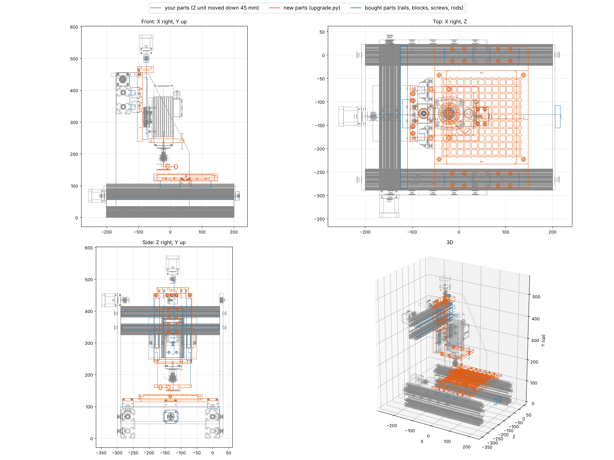

# Machine upgrade: every improvement, modelled on the original assembly

All new parts are built in **Ana_Montaj's own coordinates** (`upgrade.py`).
- **Placing them:** in SolidWorks, Insert → Component → `step/upgrade_assembly.step`, then mate its origin to the assembly
  origin (or tick "fix at origin"). Every part lands in place.
- **Hiding replaced parts:** suppress the parts listed under *Replaces*.
- **Moving the Z unit:** move it down 45 mm and forward 6 mm (`ZSHIFT` below).
- **Clash check:** `upgrade_check.py` ran it against the real parts. It found no overlaps, except the expected ones:
  screws inside their nuts and couplers, and stand-in boxes around rails.

## What changes and why

| # | Change | New part (step/upgrade/) | Replaces | Fixes |
|---|---|---|---|---|
| 1 | Z unit lowered 45 mm, Z rails 150 → 195 mm | `y_carriage_plate.step` | Tabla2 | a standard PCB bit couldn't reach the board (37 mm short) |
| 2 | Two Y rails, one HGH15CA block on each | `y_carriage_plate.step` | Y eksen Ray + 1 × HGW15CC | the spindle hung from a single block and tilted under thrust |
| 3 | Z thrust in 2 × 608 bearings, motor on standoffs | `z_top_plate_608x2.step` | Arka Kapak | spindle weight and thrust were on the stepper's own bearing |
| 4 | Two HGH15CA blocks per X rail, M4 screws | `x_table_4block.step` | 300x250 Is Tablasi | table could rock on one block per rail; M5 screws were in M4 threads |
| 5 | Vacuum hold-down with registration pins | `vacuum_plate_200x200.step` | (new) | boards held by tape/clamps, not flat |
| 6 | Spring pressure foot + dust shoe | `pressure_foot_dustshoe.step` | (new) | board flex, exit burrs, depth from Z0 only, FR4 dust |
| 7 | Camera on the head (moves with the spindle) | `head_yoke_camera.step` | separate camera stand | alignment needed a separate camera; now fiducials are found before drilling |
| 8 | X screw held at the front | `../x_front_plate_KFL08.step` | On_Kapak-Son | 255 mm screw free at the front, nut working at its tip |
| 9 | Anti-backlash nuts | `../nut_block_antibacklash_Tr8.step` | Y/Z nut blocks | 0.1–0.3 mm play |
| 10 | Limit/home switches | `../limit_sensor_bracket_M12.step` | (new) | no homing, Z blocks could run off their rails |

**ZSHIFT = (+6, −45, 0) mm** applies to the Z unit: holder, spindle, collet, Z blocks, Z nut and screw, which move
together.
- The Z motor and coupler move +6 in X, and the motor rises 60 mm onto its standoffs.
- The top link (`Y eksen takozu`) and the Y nut don't move.

## Result (from the model)

| | Before | After |
|---|---|---|
| X travel | 232 mm | **240 mm** (blocks reach the rail ends) |
| Y travel | 191 mm | 191 mm (unchanged: side plates) |
| Z travel | 67 mm | **~115 mm** (14 down, ~100 up) |
| Reaches the board with a 38 mm PCB bit | no (37 mm short) | **yes**: at the bottom of Z the tip is 24 mm below a board on the vacuum plate |
| Y carriage | 1 block on 1 rail | 2 rails, 2 blocks |
| X table | 1 block per rail | 2 blocks per rail |
| Thrust bearings | Y only | X (KFL08), Y (626), Z (2 × 608) |

**Long bits no longer fit.** The 127 mm Ø10 drill in the model would now hit the table. With the Z unit 45 mm
lower, use normal PCB bits, or keep a 40 mm spacer under the work for long tools.

**Machine settings after the upgrade.** Set `$130-$132` (and `machine.travel_mm`) to about **235 / 185 / 105** mm.
Measure them first.

## How the new parts fit together

- **Y carriage plate.** 16 mm thick, 215 tall (y 240–455).
  - The back face stays at x = −104, so `Y eksen takozu` still bolts on.
  - 7 mm pockets take the two HGH15CA blocks, so their top faces sit at x = −97 on rails in the cross profile's slots
    (rail centres y 347.5 / 392.5).
  - The Z rails go on the front face at z −175.3 / −75.3, with M4 holes on a 60 mm pitch.
  - The top face has 4 × M5 tapped holes for the top plate. The originals were modelled Ø5, which matches neither M5
    nor M6. M5 tapped is now consistent with the Ø5.5 holes in the top plate.
- **Z top plate.** 20 mm thick.
  - 2 × 608ZZ, one pressed in from each side, with a 5 mm shoulder between them.
  - Clamp the screw journal (Tr8 crests, Ø8) with lock collars above and below.
  - The motor sits on 4 × M3×50 standoffs, and the original coupler goes between the collar and the motor.
- **X table.** Same outline, lanes, pocket and nut recess as yours.
  - 4 blocks at X = table centre ± 49 mm, each on M4 26 × 26.
  - 4 × M5 tapped holes at (±90, ±90) for the vacuum plate.
- **Vacuum plate.** 12 mm aluminium.
  - 3 × 2 mm groove grid at a 15 mm pitch over 170 × 170 mm.
  - Fed from a G1/8 port in the +X edge through a Ø6 channel.
  - Put a 3 mm MDF sheet on it (porous bleeder and sacrificial backer), and the PCB on that.
  - Ø3 pins at ±95 mm register double-sided boards.
  - Any shop vac or a small vacuum pump works.
- **Head yoke.** Bolts under the spindle holder with 2 × M5. Tap two M5 holes in the holder's bottom face at
  z = −177.3 / −73.3, x = −65.5 (in the original coordinates).
  - The arms pass 8 mm clear of the spindle body.
  - Each arm holds a 6 × 10 × 10 bronze bushing for a pressure-foot rod.
  - The front bar holds an **Ø8 USB endoscope camera**, 58 mm in front of the spindle, with an M3 set screw.
- **Pressure foot.** Two Ø6 × 110 rods pressed into the foot slide in the yoke bushings, and two springs push the foot
  down (Ø6.5 bore, ~70 mm free length, 0.2–0.3 N/mm).
  - At rest the foot is 2 mm below the bit tip (20 mm out of the collet).
  - It flattens the board before the bit touches it and has a 12 mm stroke.
  - The Ø16 port takes a vacuum hose, and air comes in through 4 grooves in the face.
  - Print it in PETG or machine it from POM.

## New screws

| Where | Was | Now |
|---|---|---|
| top link (takozu) → carriage plate | M5×12 | **M5×20** (plate is 16 mm) |
| HGH15CA Y blocks → carriage plate | (HGW15CC M5) | **8 × M4×16** |
| HGH15CA X blocks → table | M5×12 (wrong thread) | **16 × M4×12** |
| top plate → carriage plate | M5×12 | **4 × M5×25** |
| motor → standoffs | M3×12 | 4 × M3×8 + **4 × M3×50 standoffs** (M-F) |
| vacuum plate → table | – | **4 × M5×20** |
| yoke → holder | – | **2 × M5×16** |

## Buy list (upgrade only; the earlier list in README.md still applies)

| Qty | Part |
|---|---|
| 4 | HGR15 rail: 2 × ~306 mm (Y), 2 × 195 mm (Z) → buy 2 × 310 + 2 × 200 and cut |
| 4 | HGH15CA block: 2 for Y, 2 extra for X (you have 2) |
| 2 | 608ZZ bearing + 2 × 8 mm lock collar (Z thrust) |
| 1 | Tr8x2 lead screw 250 mm (Z, cut to 230) |
| 4 | M3×50 standoff, male-female |
| 2 | Ø6 × 110 mm hardened rod, 2 × bronze bushing 6×10×10, 2 × spring Ø6.5 × 70 |
| 1 | Ø8 mm USB endoscope camera (fixed focus ~3–8 cm, with LEDs) |
| 1 | 12 mm aluminium plate 200 × 200, G1/8 hose fitting, 3 mm MDF sheets |
| 1 | shop vac (dust + hold-down) or small vacuum pump, Ø16 hose |
| – | screws from the table above |

## Not modelled, and why

- **Ball screws (SFU1204 + BK10/BF10).** These are the next step past anti-backlash nuts. Nut flange and support
  dimensions vary between sellers, and they could not be confirmed from a datasheet. Model the nut housings and supports
  to the listing you actually buy.
- **A faster spindle.** The HMA85 at 18,000 rpm is fine for 0.6 mm bits and up. Check its runout with a dial gauge
  on a ground pin in the collet first. Under 0.01 mm is good.
- **Electronics** are covered in `../electronics/README.md` (E-stop, limits, current sensing).
- **The SolidWorks files are unchanged.** No .SLDPRT or .SLDASM files are written. The STEP parts import as
  normal SolidWorks parts you can edit.

## Software for the head camera

The app has two new buttons on the camera page:
- **Calibrate head camera.** Drill one test hole, then press it. The machine looks at the hole from three positions
  and stores the camera's offset and orientation.
- **Align board to fiducials.** Give 1–3 design coordinates of holes or round pads on the board. The camera finds
  them and the job is rotated and shifted to the board's real position before drilling.

Both are tested against a simulated camera, which recovered a 1.5° board rotation to within 0.03°
(`tests/test_align.py`). See `../CALIBRATION.md` §12.
