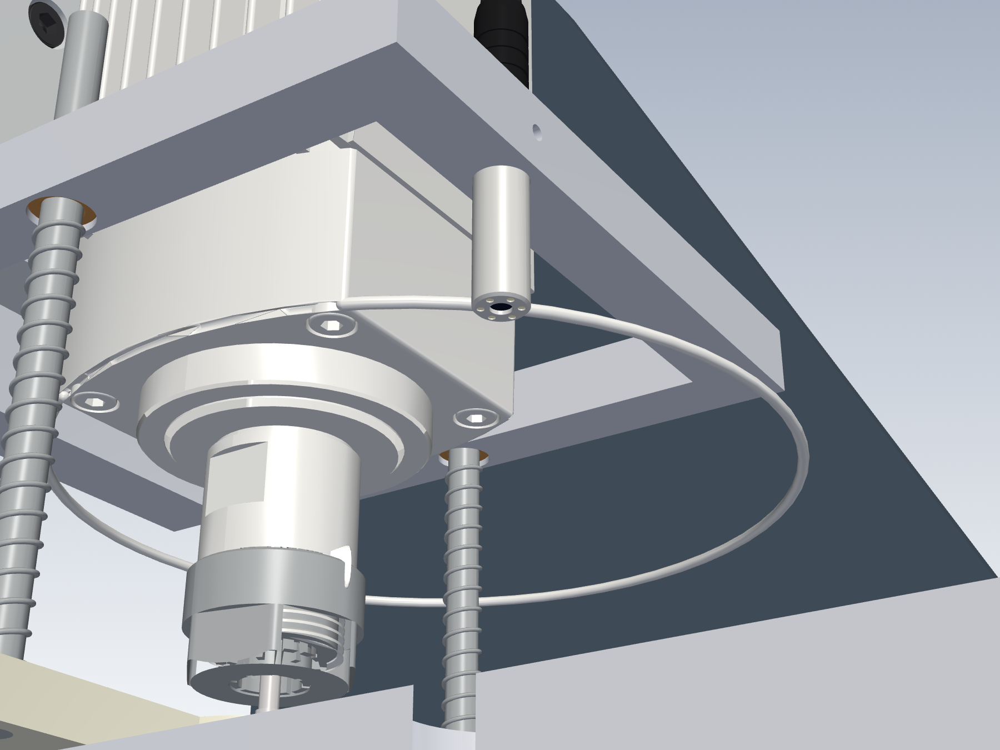
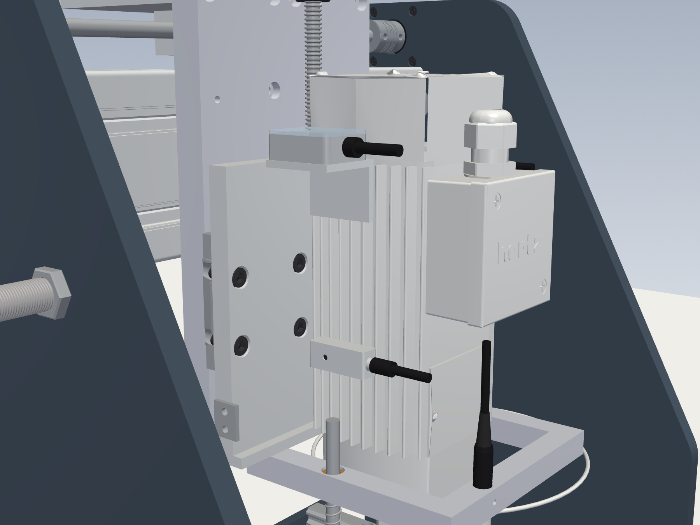
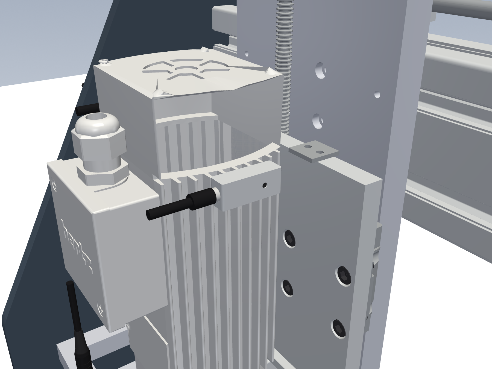
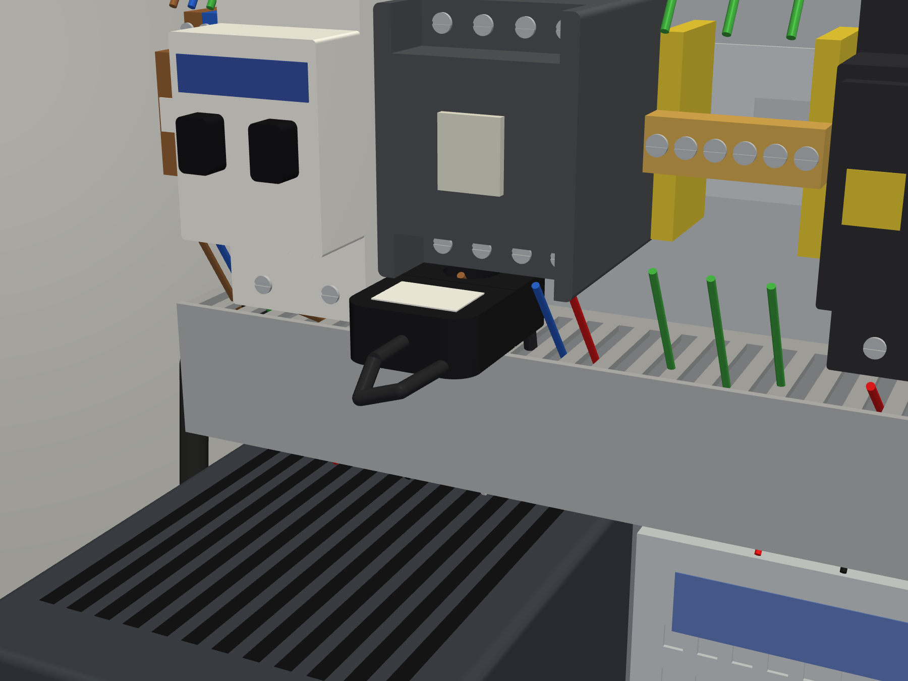
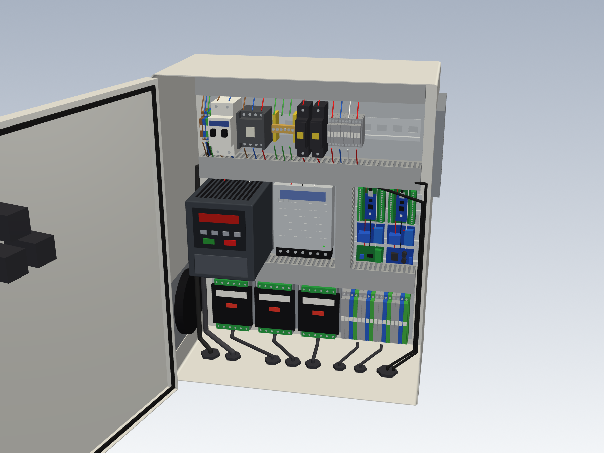
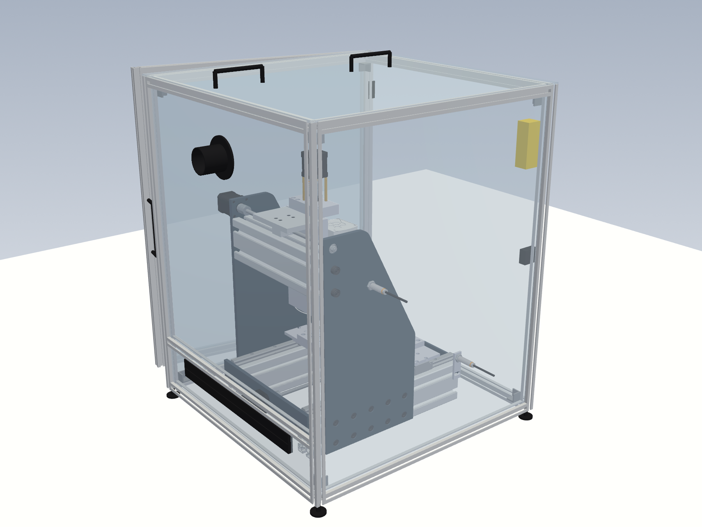
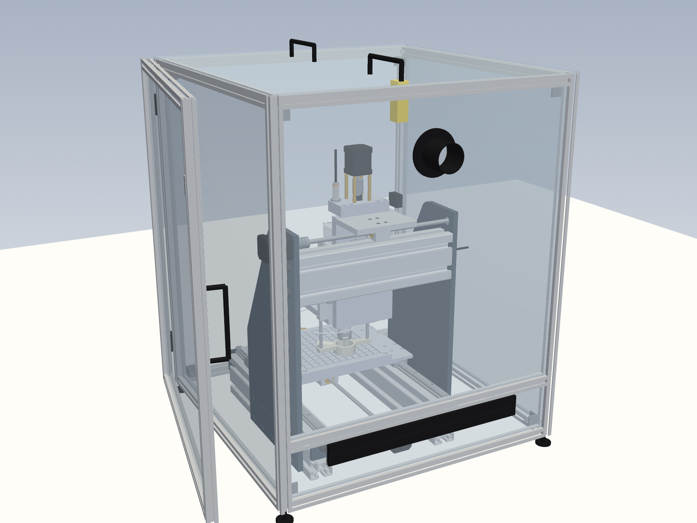

# Machine upgrade: every improvement, modelled on the original assembly

## Full CAD (open these first)

| File | What it is |
|---|---|
| `step/full_machine_upgraded.step` | the whole machine with every upgrade fitted and every sensor in place: 195 parts, names and colours |
| `step/full_machine_original.step` | the machine as built for the graduation project, 135 parts |
| `step/electrical_box.step` | the electrical enclosure with every component, the wiring that leaves the ducts, door open |
| `step/full_machine_enclosed.step` | the upgraded machine inside its cover, door open |
| `step/enclosure.step` | the cover on its own (frame, panels, door, lid, hardware) |
| `pictures/` | renders of all of them |

- **Z is up**, so the files open the right way round in FreeCAD (File → Import, or drag the file in), Fusion and
  most CAM. SolidWorks users: the frame is Ana_Montaj's turned 90° about X.
- **The original parts are your real geometry.** `full_assembly.py` rebuilds every body of `Ana_Montaj_1_6_25.x_t`
  face by face on its exact surfaces (`xt/brep.py`), so nothing is approximated. A few small, curved bought parts
  (spindle, collet and collet nut, one coupler, one 626 bearing) come through with small seam defects: they look
  right, but a CAD check may report them as not fully closed.
- **The bought parts are modelled from their catalogue outlines** (`bought.py`): HIWIN rails and blocks (copied from
  the HIWIN models in your assembly and cut to the new lengths), Tr8x2 screws, KFL08, 608ZZ, lock collars, standoffs,
  LJ12A3 sensors with nuts and cables, springs, bushings, the endoscope and the PCB drill.
- **Regenerate:** `python3 full_assembly.py <Ana_Montaj.x_t>`, `python3 electrical_box.py`, and
  `xvfb-run -a python3 render_full.py <Ana_Montaj.x_t> pictures original upgraded box` for the pictures.
- The older wireframe check views are still in `upgrade_views.png`.

All new parts are built in **Ana_Montaj's own coordinates** (`upgrade.py`).
- **Placing them:** in SolidWorks, Insert → Component → `step/upgrade_assembly.step`, then mate its origin to the assembly
  origin (or tick "fix at origin"). Every part lands in place.
- **Hiding replaced parts:** suppress the parts listed under *Replaces*.
- **Moving the Z unit:** move it down 45 mm and forward 6 mm (`ZSHIFT` below).
- **Clash check:** `upgrade_check.py` ran it against the real parts. It found no overlaps, except the expected ones:
  screws inside their nuts and couplers, and stand-in boxes around rails. It also checks the new parts against each
  other (sensors, targets, brackets) and the gap at each home switch's trigger point.

## What changes and why

| # | Change | New part (step/upgrade/) | Replaces | Fixes |
|---|---|---|---|---|
| 1 | Z unit lowered 45 mm, Z rails 150 → 195 mm | `y_carriage_plate.step` | Tabla2 | a standard PCB bit couldn't reach the board (37 mm short) |
| 2 | Two Y rails, one HGH15CA block on each | `y_carriage_plate.step` | Y eksen Ray + 1 × HGW15CC | the spindle hung from a single block and tilted under thrust |
| 3 | Z thrust in 2 × 608 bearings, motor on standoffs | `z_top_plate_608x2.step` | Arka Kapak | spindle weight and thrust were on the stepper's own bearing |
| 4 | Two HGH15CA blocks per X rail, M4 screws | `x_table_4block.step` | 300x250 Is Tablasi | table could rock on one block per rail; M5 screws were in M4 threads |
| 5 | Vacuum hold-down with registration pins | `vacuum_plate_200x200.step` | (new) | boards held by tape/clamps, not flat |
| 6 | Spring pressure foot + dust shoe | `pressure_foot_dustshoe.step` | (new) | board flex, exit burrs, depth from Z0 only, FR4 dust |
| 7 | Camera on the head (moves with the spindle) | `head_yoke_camera.step` | separate camera stand | alignment needed a separate camera; now fiducials are found before drilling |
| 8 | X screw held at the front | `../x_front_plate_KFL08.step` | On_Kapak-Son | 255 mm screw free at the front, nut working at its tip |
| 9 | Anti-backlash nuts | `../nut_block_antibacklash_Tr8.step` | Y/Z nut blocks | 0.1–0.3 mm play |
| 10 | Home switches on X, Y and Z | `x_limit_bracket.step`, `y_home_flag.step`, `z_home_flag.step` | (new) | no homing, Z blocks could run off their rails, axes could crash into their ends |

**ZSHIFT = (+6, −45, 0) mm** applies to the Z unit: holder, spindle, collet, Z blocks, Z nut and screw, which move
together.
- The Z motor and coupler move +6 in X, and the motor rises 60 mm onto its standoffs.
- The top link (`Y eksen takozu`) and the Y nut don't move.

## Result (from the model)

| | Before | After |
|---|---|---|
| X travel | 232 mm | **240 mm** (blocks reach the rail ends) |
| Y travel | 159 mm | 159 mm (unchanged: the 152 mm spindle holder meets the side plates; 191 mm in an earlier version was wrong) |
| Z travel | 67 mm | **~115 mm** (14 down, ~100 up) |
| Reaches the board with a 38 mm PCB bit | no (37 mm short) | **yes**: at the bottom of Z the tip is 24 mm below a board on the vacuum plate |
| Y carriage | 1 block on 1 rail | 2 rails, 2 blocks |
| X table | 1 block per rail | 2 blocks per rail |
| Thrust bearings | Y only | X (KFL08), Y (626), Z (2 × 608) |

**Long bits no longer fit.** The 127 mm Ø10 drill in the model would now hit the table. With the Z unit 45 mm
lower, use normal PCB bits, or keep a 40 mm spacer under the work for long tools.

**Machine settings after the upgrade.** Set `$130-$132` (and `machine.travel_mm`) to about **230 / 150 / 105** mm.
These are the travels left between the home position and the far ends. Measure them first.

## How the new parts fit together

- **Y carriage plate.** 16 mm thick, 215 tall (y 240–455).
  - The back face stays at x = −104, so `Y eksen takozu` still bolts on.
  - 7 mm pockets take the two HGH15CA blocks, so their top faces sit at x = −97 on rails in the cross profile's slots
    (rail centres y 347.5 / 392.5).
  - The Z rails go on the front face at z −175.3 / −75.3, with M4 holes on a 60 mm pitch.
  - The top face has 4 × M5 tapped holes for the top plate. The originals were modelled Ø5, which matches neither M5
    nor M6. M5 tapped is now consistent with the Ø5.5 holes in the top plate.
- **Z top plate.** 20 mm thick.
  - 2 × 608ZZ, one pressed in from each side, with a 5 mm shoulder between them.
  - Clamp the screw journal (Tr8 crests, Ø8) with lock collars above and below.
  - The motor sits on 4 × M3×50 standoffs, and the original coupler goes between the collar and the motor.
- **X table.** Same outline, lanes, pocket and nut recess as yours.
  - 4 blocks at X = table centre ± 49 mm, each on M4 26 × 26.
  - 4 × M5 tapped holes at (±90, ±90) for the vacuum plate.
- **Vacuum plate.** 12 mm aluminium.
  - 3 × 2 mm groove grid at a 15 mm pitch over 170 × 170 mm.
  - Fed from a G1/8 port in the +X edge through a Ø6 channel.
  - Put a 3 mm MDF sheet on it (porous bleeder and sacrificial backer), and the PCB on that.
  - Ø3 pins at ±95 mm register double-sided boards.
  - Any shop vac or a small vacuum pump works.
- **Head yoke.** Bolts under the spindle holder with 2 × M5. Tap two M5 holes in the holder's bottom face at
  z = −177.3 / −73.3, x = −65.5 (in the original coordinates).
  - The arms pass 8 mm clear of the spindle body.
  - Each arm holds a 6 × 10 × 10 bronze bushing for a pressure-foot rod.
  - The front bar holds an **Ø8 USB endoscope camera**, 58 mm in front of the spindle, with an M3 set screw.
    The camera is modelled like the real part: stainless tip with the lens and a ring of 6 LEDs, black grip, strain
    relief and cable. Its lens sits 20 mm under the yoke, looking straight down.

    
- **Pressure foot.** Two Ø6 × 110 rods pressed into the foot slide in the yoke bushings, and two springs push the foot
  down (Ø6.5 bore, ~70 mm free length, 0.2–0.3 N/mm).
  - At rest the foot is 2 mm below the bit tip (20 mm out of the collet).
  - It flattens the board before the bit touches it and has a 12 mm stroke.
  - The Ø16 port takes a vacuum hose, and air comes in through 4 grooves in the face.
  - Print it in PETG or machine it from POM.

## Sensors on the machine

Every sensor the DAQ board and GRBL read is in the model, where it would be fitted:

| Sensor | Where | Reads | Wiring |
|---|---|---|---|
| 3 × LJ12A3-4-Z/BX inductive | X, Y and Z axis ends (*Home switches* below) | home and limits, GRBL D9/D10/D12 | `../electronics/README.md` §3.5 |
| DS18B20 probe 1 | front face of the spindle body, lower bearing end | spindle temperature, DAQ A2 | §3.6 |
| DS18B20 probe 2 | back face of the spindle body, upper bearing end | spindle temperature, same 1-Wire bus | §3.6 |
| ADXL345 (GY-291 board) | on a small angle bonded to the front face of the spindle body, upper bearing end | vibration and tilt, DAQ A4/A5 | §3.6 |
| SCT-013-005 current transformer | in the electrical box, clipped round the L wire from K1 to the VFD | spindle current, DAQ A0 | §3.4 |
| VFD analog output | inside the J1000 (AM-AC terminals) | spindle load, DAQ A1 | §3.4 |
| Head camera (Ø8 endoscope) | head yoke, 58 mm from the drill | quality check against the drawing | *Software for the head camera* |
| Cover door switch S2 | cover frame (*Machine cover*) | door open, GRBL A1 and K1 | §3.1 |

- **Fixing them to the spindle.** The temperature probes sit in aluminium clamp blocks (30 × 12 × 9 mm, Ø6.2 bore, M3
  grub screw), bonded to flat faces of the spindle body with thermal epoxy, so no holes go into the spindle.
- **The ADXL345 board** sits in a 32 × 26 × 12 mm aluminium box with a clear lid and a cable gland. The box stands on
  the shelf of a 3 mm aluminium angle, which is bonded to the spindle's front face the same way. The board lies flat,
  with its Z axis vertical, because the app works out tilt from that axis (`app/daq.py`).
- **The current sensor** clips round the single L conductor, never round the whole cable. With L and N together, the
  currents cancel and it reads zero.

## Home switches

Three LJ12A3-4-Z/BX inductive sensors (M12, 4 mm range on steel, wired as in `../electronics/README.md` §3.5). Each one
sees a steel target and triggers 3 mm from it, a few mm before the axis reaches a hard stop. GRBL homes each axis
to its **+ end**: Z first, then X and Y together (GRBL's default `HOMING_CYCLE_0` / `_1`; keep them).

| Axis | Sensor | Target | Triggers | Hard stop after the trigger |
|---|---|---|---|---|
| X | `x_limit_bracket.step` on the outside of the front base profile (M8 T-bolt, slotted ±5 mm). Sensor at x 192, y 106 | side of the front rail's leading HGH15CA block (steel, no part needed) | block edge at x ≈ 192 | ~8 mm (blocks reach the rail ends at x 200) |
| Y | new **M12x1 thread in `Yan_Plaka_2`** at x −59.5, y 340, face flush with the inside | `y_home_flag.step`: 2 mm steel on the spindle holder's end face, 2 × M3 | 66.8 mm from the model pose | 5.0 mm (holder meets the side plate) |
| Z | new **Ø11 hole, tapped M12x1, in the Z top plate** at x −64, z −165 | `z_home_flag.step`: 2 mm steel on the holder's top face, 2 × M3 | 97.8 mm above the model pose | 3.0 mm (holder top meets the top plate) |

- **The Y target is on the holder, not the carriage plate.** The holder is 152 mm wide and the carriage plate only 120,
  so the holder reaches the side plate first. The target moves with Z: it sits in front of the sensor only once Z has
  homed (holder 96.8 mm up). That is why Z must home first. Don't change the homing cycles in `config.h`.
- **Sensors screw into tapped M12x1 threads** with the lock nut outside. There is no room for a nut on the inside of the
  side plate, the bracket or the top plate.
- **Setting the trigger point:** with the machine off, push the axis by hand until the target is 3 mm from the
  sensor (a 3 mm drill shank as a feeler) and check that the sensor LED lights. Adjust X with the bracket slot. Y and Z
  are set by the part geometry; if needed, shim the target.
- **Directions.** After `$3` is set so that + jogs go + (`../CALIBRATION.md` §1), + must move X towards the
  bracket end (x +), Y towards `Yan_Plaka_2` and Z up. If an axis's switch is at its − end instead, set its bit in `$23`
  (X = 1, Y = 2, Z = 4).
- **Software:** set `machine.homing.enabled: true` in `config.yaml` and press *Apply machine settings*. The app then
  shows *Home machine ($H)* and refuses to start a job until the machine has homed (`../CALIBRATION.md` §6).
- **Y − end and X − end have no switch.** Soft limits (`$20=1`, set by the app with homing) stop moves past `$130-$132`
  from home, and the X/Y hard limits only guard the + end.

## New screws

| Where | Was | Now |
|---|---|---|
| top link (takozu) → carriage plate | M5×12 | **M5×20** (plate is 16 mm) |
| HGH15CA Y blocks → carriage plate | (HGW15CC M5) | **8 × M4×16** |
| HGH15CA X blocks → table | M5×12 (wrong thread) | **16 × M4×12** |
| top plate → carriage plate | M5×12 | **4 × M5×25** |
| motor → standoffs | M3×12 | 4 × M3×8 + **4 × M3×50 standoffs** (M-F) |
| vacuum plate → table | – | **4 × M5×20** |
| yoke → holder | – | **2 × M5×16** |
| home targets → holder | – | **4 × M3×6** (tap M3 in the holder) |
| X sensor bracket → base profile | – | **2 × M8×12 + T-nuts** |

## Buy list (upgrade only; the earlier list in README.md still applies)

| Qty | Part |
|---|---|
| 4 | HGR15 rail: 2 × ~306 mm (Y), 2 × 195 mm (Z) → buy 2 × 310 + 2 × 200 and cut |
| 4 | HGH15CA block: 2 for Y, 2 extra for X (you have 2) |
| 2 | 608ZZ bearing + 2 × 8 mm lock collar (Z thrust) |
| 1 | Tr8x2 lead screw 250 mm (Z, cut to 230) |
| 4 | M3×50 standoff, male-female |
| 2 | Ø6 × 110 mm hardened rod, 2 × bronze bushing 6×10×10, 2 × spring Ø6.5 × 70 |
| 1 | Ø8 mm USB endoscope camera (fixed focus ~3–8 cm, with LEDs) |
| 1 | 12 mm aluminium plate 200 × 200, G1/8 hose fitting, 3 mm MDF sheets |
| 1 | shop vac (dust + hold-down) or small vacuum pump, Ø16 hose |
| 3 | LJ12A3-4-Z/BX inductive sensor, M12 (if not bought for the electronics already) |
| 1 | 5 mm aluminium 20 × 63 (X bracket), 2 mm steel scraps (targets) |
| – | screws from the table above |

## Stiffness: before and after (`stiffness.py`, `stiffness_report.txt`)

Hand calculation of how far the drill tip moves under 20 N of thrust and 5 N of side load, with the same beam and
spring method as the router. Bolted joints are taken as rigid, and the guide block and profile values are typical
catalogue values (listed in the script), so read it as a comparison, not as exact numbers.

| 20 N thrust | Before | After |
|---|---|---|
| Tip pushed sideways (moves the hole while the bit enters) | 73 µm | **40 µm** |
| Tip pushed up (depth) | 40 µm | **20 µm** |
| Largest term | Y carriage rolling on its single block (42 µm) | cross profile twisting (29 µm) |

- The two Y rails remove the worst term (42 → 4 µm). The four X blocks remove the table rocking (4 → 0.2 µm).
- **The cross profile is now the weak point.** A 45×90 light profile is weak in torsion, and the lower Z unit gives the
  thrust a longer lever. Closing it into a torsion box (6 mm plates forming a 96 × 96 cell behind the profile) would
  bring the sideways error to about 11 µm. That is the next upgrade if holes still walk. It is not modelled, because
  the box has to pass behind the side plates and needs its own end plates.
- A second block on each Z rail (they are now 195 mm long) would cut the Z block term (7 µm) by about 10×.

## Electrical enclosure (`electrical_box.py`)

The wiring layout with labels and the rules behind it is `electrical_box.png`.

- **Box and plate.** One 400 × 500 × 210 mm earthed steel wall box (IP55 or better) replaces the open wooden board.
  The 360 × 460 mounting plate holds everything in `../electronics/diagrams/6_system_overview.png`.
  `step/electrical_box.step` models every part with its real shape (DIN rail, MCB, contactor, terminals, J1000,
  LRS-100-24, TB6600s, the Nanos on DIN carriers, relays), the ducts, glands, fan, door devices and the cables
  that leave the ducts.
- **Power side and signal side.**
  - Mains, the VFD and the PSU are on the left. The Nanos, relays and PWM module are on the right, and a vertical duct
    separates the two sides.
  - The stepper drivers and the field terminals sit along the bottom, and every cable leaves through a bottom gland.
  - The VFD to spindle cable goes through an EMC gland with its shield clamped all round.
- **The script checks the layout:**
  - no part overlaps another or a duct
  - every part clears the door (the deepest is the VFD at 138 mm, and the door is 193 mm from the plate)
  - the E-stop and Start contact blocks sit in front of the DIN row, not the VFD
- **Heat.**
  - About 63 W is lost inside the box, which would raise a sealed box about 20 K above room temperature.
  - So it has a 120 mm filter fan low on the left and an exhaust filter high on the right, which keeps the rise near
    10 K. The J1000 is rated for 50 °C.
- **Check the VFD's size** on its label. J1000 frame sizes differ by rating, and the layout uses the larger 108 × 128
  frame.

## Machine cover (`enclosure.py`)

A cage of 20 × 20 aluminium profile with clear polycarbonate panels. It sits on the bench on four levelling feet,
and the machine stands inside it on its own feet, so the cover does not touch the machine and carries no load.

- **Size:** 590 × 570 mm footprint, 716 mm high. It clears the machine at every axis position by 22.5 mm on the
  sides, 24 mm front and back, and 117 mm above the highest point (the Z motor). `enclosure.py` checks this against
  the machine's outline with the table at both ends of its X travel. The Y and Z axes move inside the machine's own
  frame, so they do not change it. Cables are modelled as rigid, so leave them some slack at the brush strip.
- **Door:** the whole front panel, on its own profile frame, hinged on one side and held shut with a magnetic catch.
  It opens to 100° and more, so a 200 × 200 PCB and the vacuum table go in and out straight.
- **Door interlock (S2):** a safety switch with a separate actuator key (Omron D4NS type) on the frame, with two NC
  contacts:
  - one in series with the E-stop in the K1 coil circuit, so opening the door cuts the spindle and motor power in
    hardware;
  - one to GRBL **A1** (safety door input), so GRBL also stops and reports `Door`.
  The wiring is in `../electronics/README.md` §3.1 and `../electronics/diagrams/1_mains_estop.png`.
- **Lid:** a 6 mm polycarbonate sheet with two handles, resting on the top frame. Lift it off for work on the Z motor.
- **Dust:** a Ø50 mm extraction port high on the back panel, for a shop vacuum. Cables leave through a brush strip in
  the low back panel, so the cable chains and sensor cables move freely.

 

### Cut list (`enclosure_cut_list.txt`)

| Part | Qty | Size (mm) |
|---|---|---|
| 20 × 20 profile, frame verticals | 4 | 690 |
| 20 × 20 profile, frame front to back | 4 | 530 |
| 20 × 20 profile, frame left to right (incl. back middle rail) | 5 | 530 |
| 20 × 20 profile, door verticals | 2 | 690 |
| 20 × 20 profile, door horizontals | 2 | 530 |
| Polycarbonate 4 mm, sides | 2 | 540 × 660 |
| Polycarbonate 4 mm, back low (brush strip) | 1 | 100 × 540 |
| Polycarbonate 4 mm, back high (Ø50 port) | 1 | 550 × 540 |
| Polycarbonate 4 mm, door | 1 | 660 × 540 |
| Polycarbonate 6 mm, lid | 1 | 570 × 570 |

The profile totals 9.97 m: buy six 2 m bars and cut each into 690 + 530 + 530 (one 530 is spare).

### Buy list (cover)

| Item | Qty |
|---|---|
| 20 × 20 aluminium profile, 6 mm slot, 2 m bars | 6 |
| Polycarbonate sheet 4 mm (cut to the list above), 6 mm for the lid | about 1.6 m² + 0.33 m² |
| 20-series inner corner brackets with screws | 32 |
| M5 T-nuts (slot 6) and M5 × 8 button head screws for the panels | 60 each |
| 20-series hinges | 2 |
| Pull handles, 100 to 120 mm | 3 (door and lid) |
| Magnetic catch | 1 |
| Safety interlock switch with actuator key, 2 NC (Omron D4NS-4AF or similar) | 1 |
| Ø50 mm dust port flange | 1 |
| Brush strip, 540 mm | 1 |
| M8 levelling feet | 4 |

### Opening the door during a job

The interlock cuts the stepper power, so the motors lose their position if they are moving when the door opens. GRBL
will need homing again. To look at or change something mid-job, press **Pause** first, wait until the machine stands
still, then open the door. Closing the door does not restart anything: press Start on the box, then home.

## Not modelled, and why

- **Ball screws (SFU1204 + BK10/BF10).** These are the next step past anti-backlash nuts. Nut flange and support
  dimensions vary between sellers, and they could not be confirmed from a datasheet. Model the nut housings and supports
  to the listing you actually buy.
- **A faster spindle.** The HMA85 at 18,000 rpm is fine for 0.6 mm bits and up. Check its runout with a dial gauge
  on a ground pin in the collet first. Under 0.01 mm is good.
- **Electronics** are covered in `../electronics/README.md` (E-stop, limits, current sensing). A layout for the
  enclosure is in `electrical_box.py` (below).
- **The SolidWorks files are unchanged.** No .SLDPRT or .SLDASM files are written. The STEP parts import as
  normal SolidWorks parts you can edit.

## Software for the head camera

The head camera does the quality control: it checks every drilled hole against the drawing the job came from
(points or DXF). It also lines the board up before drilling. The buttons are on the camera page:
- **Calibrate head camera.** Drill one test hole, then press it. The machine looks at the hole from three positions
  1 mm apart and stores the camera's offset and orientation.
- **Align board to fiducials.** Give 1–3 design coordinates of holes or round pads on the board. The camera finds
  them and the job is rotated and shifted to the board's real position before drilling.
- **Quality check vs drawing.** The camera visits every hole of the job, measures where its centre really is and
  its diameter, and compares both with the drawing.
  - Each hole is seen close up in the middle of the picture, where the lens distorts least. Positions are measured
    in machine coordinates, so the result is the real error against the drawing, not only hole to hole.
  - The page shows one tile per hole, green when it is within the tolerance and red when it is out or missing. The
    same colours go onto the drawing on the right.
  - The text splits the error into the whole pattern's shift and rotation (board placement, work zero) and what is
    left hole to hole (the machine).
  - The measured diameter and position error of every hole go into the session database.
  - With *Quality control* ticked in the session settings, it runs by itself after the job. Without a calibrated
    head camera it falls back to one photo from an overview camera (**Capture & inspect**).

In the picture, hole 6 was moved 0.3 mm in the drawing on purpose to show a failure.

All of this is tested against a simulated head camera (`sim/camera_sim.py`, `head_view`):
- **Board alignment:** recovered a 1.5° board rotation to within 0.03°.
- **Quality check:** caught a hole 0.25 mm out of place, a 1.3 mm hole drilled with the wrong bit and a missing hole.
  It measured the good holes to within 0.01 mm (`tests/test_align.py`, `tests/test_gui_sim.py`).

See `../CALIBRATION.md` §12.
