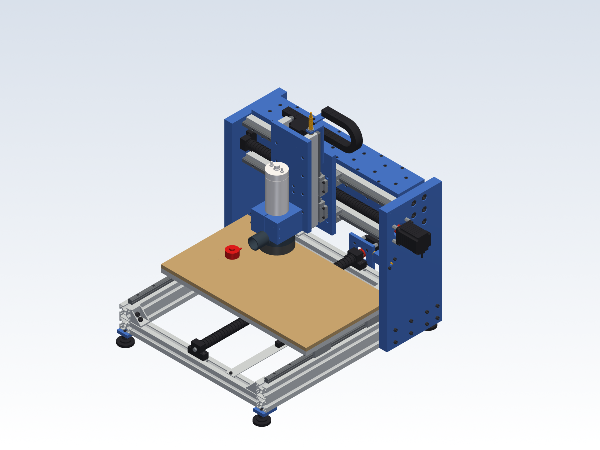

# CNC router: new design (CAD stage)

A new machine designed from scratch. It is a general-purpose vertical router for wood, plastics and aluminium. Renders, the bill of materials and drawings will come once the design is final.

## Files

The STEP files are too large for the repository. Download `router-step-files.zip` from the [Releases page](../../releases), or regenerate them with `python3 assembly.py`.

| File | What |
|---|---|
| `step/router_assembly.step` | Full assembly, 638 parts with colours, inside its enclosure, at machine position X0 Y0 Z0: every bolt, T-nut and bracket included. Opens in FreeCAD (File → Open), SolidWorks and Fusion. |
| `step/parts/*.step` | One STEP per distinct part (127 files), including each bolt size and T-nut. |
| `parts.py` | Bought parts modelled from catalogue drawings (see below). Every catalogue value is in `VENDOR`. |
| `assembly.py` | Made parts, plus the placement of every part from the machine position. |
| `render.py` | Shaded views of the assembly into `pictures/`. |
| `check.py` | Clash check at every corner of the work volume, plus margins. Writes `check_report.txt`. |
| `stiffness.py` | Hand calculation of tool deflection under 100 N in X, Y and Z (`stiffness_report.txt`). `ETA=0.25 python3 stiffness.py` reruns it with less credit for the bolted box plates. |

To regenerate everything, run `pip install cadquery`, then `python3 assembly.py` and `python3 check.py`.

To get the assembly at any position, run `python3 assembly.py X Y Z`, for example `python3 assembly.py 150 -125 -100`.

## The machine

| | |
|---|---|
| Layout | Fixed gantry. The table moves in Y; the spindle moves in X and Z. |
| Work area | **300 × 250 × 100 mm** (X ±150, Y ±125, Z −100..0) |
| Footprint | machine about 700 × 750 mm, 610 mm tall; enclosure about 880 × 920 × 760 mm |
| Base | 2 × Bosch Rexroth 40×80L **3842993130** (640 long), 2 × 40×40L **3842993120** (480 long), 4 cast corner brackets |
| Gantry | 2 × 30 mm aluminium side plates and a Bosch Rexroth 80×160L **3842993673** beam (560 long, 8 × M12 into the tapped cores), boxed in by 10 mm aluminium plates on the front, back and top |
| Guides | HIWIN HGR15 rails on every axis, 4 blocks per axis (HGH15CA on X and Y, HGW15CC on Z) |
| Drive | SFU1605 ball screws (16 mm, 5 mm lead) in BK12/BF12 supports, NEMA23 motors, clamp couplers |
| Spindle | Zhong Hua Jiang 65 mm 1.5 kW water-cooled ER11 (24 000 rpm, 3 kg), in a split clamp |
| Table | 554 × 330 × 15 mm aluminium with an M6 grid on 50 mm, 12 mm MDF spoilboard on top |

### How each axis is built

- **Y (table).**
  - Rails sit on top of the two base profiles, 520 mm apart.
  - The table rides on 4 blocks, 200 mm apart along the rail.
  - The screw runs down the middle, 25 mm above the cross members. The motor is at the back, on standoffs.
- **X (carriage).**
  - Two rails are on 20 mm risers on the beam front, 120 mm apart vertically.
  - The carriage is a 15 mm plate, 180 × 260, on 4 blocks.
  - The screw runs between the rails. The motor is outside the right side plate, driving through a Ø42 hole.
- **Z (spindle plate).**
  - The 4 blocks are fixed to the carriage front, 85 mm apart vertically.
  - The rails move with the 15 mm Z plate.
  - The motor is on top of the carriage with the screw hanging below it. The fixed BK12 is at the top, so the spindle hangs from the bearing and not from the motor.

## Added in this round

**Stiffness.** A hand calculation (`stiffness.py`) found the tool moved 16–24 µm under a 100 N cutting force. The weak points were the 20 mm side plates bending sideways and the beam twisting, because the tool hangs about 250 mm below and in front of the beam. Two changes:
- The side plates are now 30 mm thick.
- The beam is boxed in by 10 mm plates on its front, back and top, bolted into its slots. This closes the section, so it twists much less. The X risers now sit on the front plate, which also fixed the BK12 46 mm vs 40 mm slot problem without spacers.

| 100 N at the tool | Before | Now | Now, if the bolted box only gives half the credit |
|---|---|---|---|
| X | 23.5 µm | 7.0 µm | 7.0 µm |
| Y | 19.5 µm | 3.5 µm | 5.8 µm |
| Z | 16.3 µm | 2.8 µm | 4.7 µm |

The calculation treats bolted joints as rigid and leaves out the guide blocks, so the real machine will be softer. Read it as a ranking of where the flex is. What is left is mostly the side plates (X) and beam twist (Y and Z).

**Chip covers.** Round bellows (Ø29 outside, Ø18 bore) cover the X and Y ball screws on both sides of each nut. They stretch and compress with the axis in the model.

| Bellows | Shortest / longest length |
|---|---|
| Y front | 0.33 |
| Y back | 0.36 |
| X left | 0.22 |
| X right | 0.18: needs a flat-fold type, because round bellows usually only close to about 0.2 |

**Home switches.** Three M12 inductive sensors (4 mm range, PNP). Each one is 3–3.5 mm from its steel target when the axis is at its home end:
- X triggers at X +150 off a sensor block on the beam.
- Y triggers at Y −125 off a flag on the table.
- Z triggers at Z 0 on a bracket bolted to the carriage.

**Drag chains.** X: 25 × 20 mm, bend radius 38, on top of the beam. Y: 15 × 15 mm, bend radius 18, in a tray under the table.

**Dust shoe.** A clamp-mounted shoe with a brush skirt and a Ø40 hose port at the back.

**Tool-length probe.** On the spoilboard at X −170, outside the work area. X travel needs 20 mm more on the negative side to reach it.

**Feet.** Four levelling feet on plates under the base corners.

**Enclosure.** Polycarbonate panels, 6 mm, in a Bosch 40×40 frame on an 18 mm base board, about 880 × 920 × 760 mm:
- The front is a hinged door with a handle and a safety switch. The switch is wired to stop the spindle and motors when the door opens.
- The back panel has a Ø100 dust extraction port and a Ø50 hole for cables.
- Polycarbonate, not glass: it does not shatter if a tool breaks, and it is what machine guards use.

## What is real in the model

Vendor sites (HIWIN, Misumi, Bosch, TraceParts, GrabCAD) cannot be reached from where the model is built. So each bought part is modelled from its catalogue drawing, in the details that matter for fit and assembly:

| Part | Modelled |
|---|---|
| Bosch Rexroth profiles (slot 10, R40) | Hollow section: slot 10, M12 cores, skin, webs and core tubes. Bosch's datasheets give area and stiffness but no section drawing, so the walls are sized to match them. The model is within 5 % of the published area and Ix (40×80L: 10.4 vs 9.9 cm², Ix 63.1 vs 63.4 cm⁴). |
| HGR15R rail | Section with 4 ball grooves, Ø4.5/Ø7.5×5.3 counterbores at 60 pitch, equal end distances |
| HGH15CA / HGW15CC | Catalogue height, width, length and bolt pattern. Steel body, end caps, double-lip seals, M4 grease nipple. HGW15CC has through holes for bolting from below. |
| SFU1605 | Real helical ball groove (5 mm lead). Machined ends: Ø12 journals, circlip groove, Ø10 with D flat. Nut with flats, 6 × Ø5.5 holes on PCD 38, wipers and grease port. |
| BK12 / BF12 | Stepped body, counterbored M5 holes at 46, bearing cover. M12×1 lock nut. |
| NEMA23 76 mm | Cast flange with corner pockets for the bolt heads, laminated stack, rear cap, Ø38.1 boss, Ø8 shaft with flat, cable gland |
| Spindle: ZHJ 65 1.5KW ER11 | Exact to the manufacturer's drawing (catalogue 2025, p.17). Body Ø65 × 200, front Ø51.2 × 19.5, nose Ø33.5 and Ø17.8, ER11 nut Ø19 × 13. Total length 267, with the plug and water fittings behind the body. |
| Couplings | D25 L30 jaw couplings, 10 → 8 mm |
| Fasteners | ISO 4762 socket head screws at every joint (236), with real head size and hex socket. Slot-10 T-nuts (70). The threads are not drawn. |

Every bolt was checked to engage the part it fastens. Every T-nut was checked to sit against the lips of its slot.

**Changes the detailed model forced (now in the design):**
- The BK12/BF12 bolt pattern (46 mm) does not line up with the beam slots (40 mm). The X supports and risers now bolt to the 10 mm front plate of the torsion box.
- The Y supports moved onto the cross-member slot centre.
- At the top of Z, the Z ball-nut bolt heads hit the BK12. The nut housing is now 40 mm tall instead of 45.
- The Z motor's cable gland pointed into the Z plate. The motor is turned to face back.
- The HGW15CC grease nipple sat on the rail. It is moved up.

## Clash check result

There are **no clashes** at the centre or at any of the 8 corners of the work volume, with all 638 parts in place, including the bellows and drag chains at each position (`check_report.txt`). The check intersects every pair of parts. Parts that only touch, like bolted faces, pass. Bolts are checked by their heads, because their shanks sit in tapped holes drawn at tap-drill size.

The checker was also tested past the limits to make sure it works:
- At Z +10 it reports the Z nut hitting the BK12.
- At X 195 it reports the carriage hitting the right side plate.
- At Z −115 it reports the Z nut housing hitting the BF12.

Margins left at the ends of travel:

| Where | Margin |
|---|---|
| Z top: ball-nut bolt heads to BK12 | 2 mm (the Z limit switch goes here) |
| Z bottom: nut housing to BF12 | 11 mm |
| Z plate passing in front of the Z motor | 4.8 mm |
| X ends: blocks to side plates | 35 mm (grease-nipple side) and 40 mm. X could grow to about ±180 (360 mm) with nothing else changed. |
| Y blocks to side plates, Y at the front end | 3 mm |
| Spindle clamp above the spoilboard, Z at the bottom | 68 mm |

The tool reach assumes 25 mm of tool out of the collet. The tip goes from 8 mm into the spoilboard at the bottom of Z to 92 mm above it at the top, so stock up to about 90 mm thick fits.

## Honest limits of this stage

- **These are not the manufacturers' own CAD files.** They follow the catalogue drawings. Hidden internals, like balls and bearings, are not modelled. Values that vary between sellers are marked "check" in `VENDOR`: the SFU1605 nut and the BK/BF body. When you send a real STEP or a seller's drawing, it replaces the part in the same position.
- **Stiffness numbers are a hand calculation** with rigid joints and without the guide blocks. A finite-element check of the gantry is a good step before ordering the made parts.
- **Not modelled yet:** cables, hoses, the water-cooling pump and the electronics box. These go with the electronics stage.
